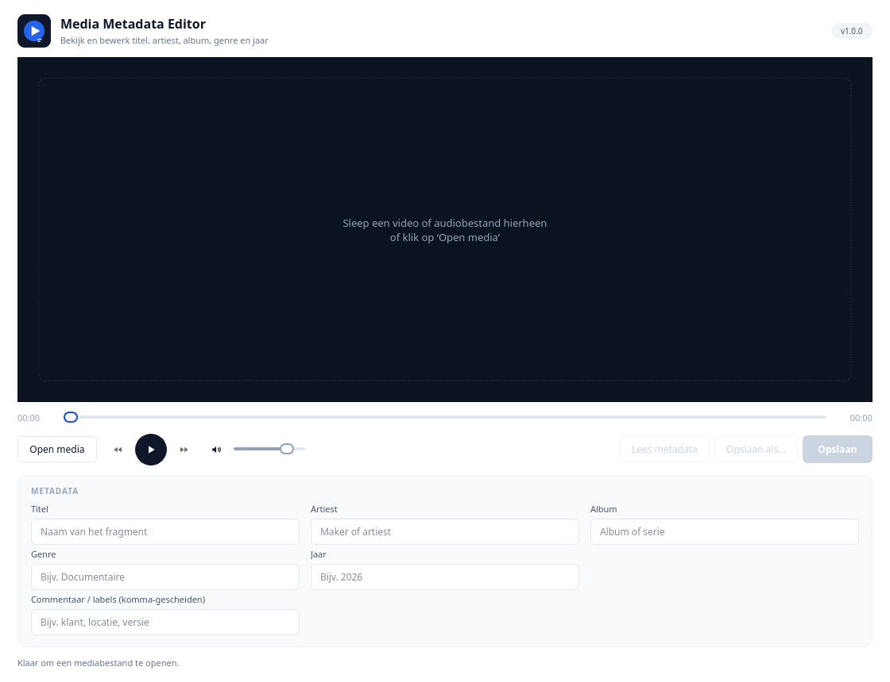
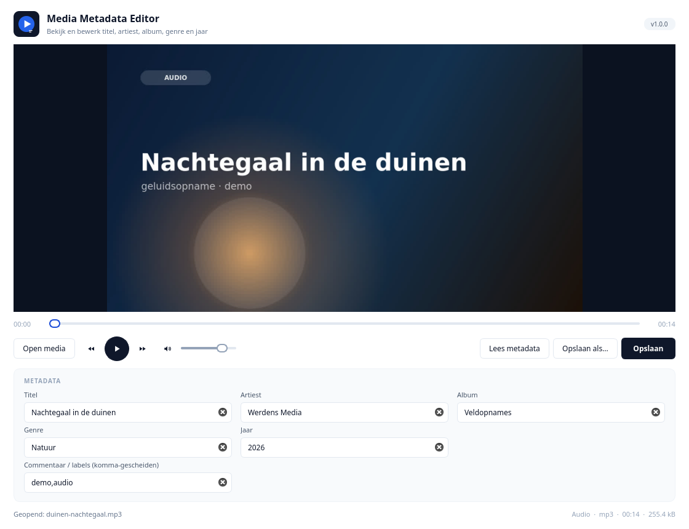
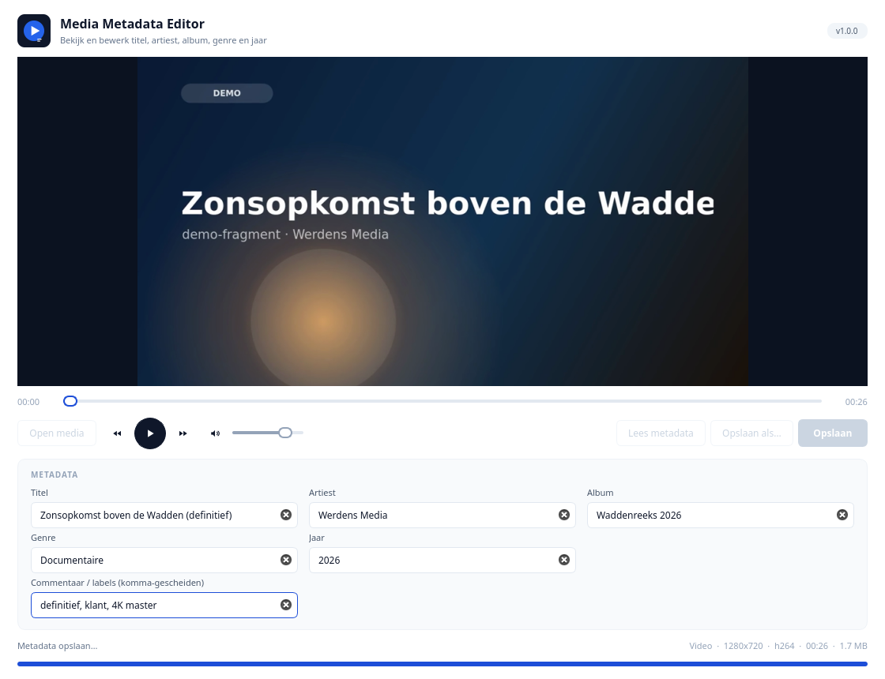
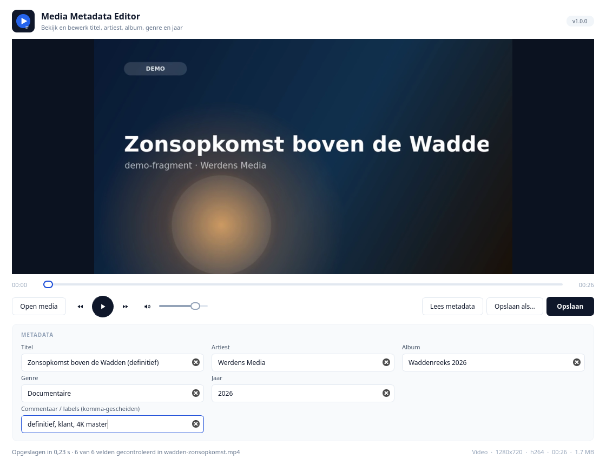

# Media Metadata Editor & Player

Bekijk en bewerk metadata (titel, artiest, album, genre, jaar, commentaar) van
video- en audiobestanden, met een speler eromheen. Windows-versie, Android-app
en de broncode staan in deze repository.


## Wat het doet

- **Spelen**: mp4, mkv, mov, avi, webm, mp3, wav, flac, m4a en meer — met
  tijdlijn, volume, −5/+5 seconden en volledig scherm.
- **Lezen**: duur, resolutie, codec, bestandsgrootte en alle tags via `ffprobe`
  (of `ffmpeg` als `ffprobe` ontbreekt).
- **Schrijven**: tags worden weggeschreven **zonder opnieuw te encoderen**
  (`-c copy`), dus beeld en geluid blijven bit-voor-bit gelijk.
- **Controleren**: na het opslaan leest de app het bestand terug en zegt per
  veld of het er echt in staat.

## Installeren

### Windows

Download `MediaMetadataEditor-Windows.zip` uit de laatste release, pak hem uit
(bijvoorbeeld naar `C:\Program Files\Media Metadata Editor`) en start
`Media Metadata Editor.exe`. ffmpeg zit erbij, dus er hoeft niets geïnstalleerd
te worden.

### Android

Download de `app-release.apk` uit de laatste release en open hem op de telefoon.
Zie [android/README.md](android/README.md) voor wat daar wel en niet kan.

## Schermafbeeldingen

| Start | Video met metadata | Audio met cover |
|---|---|---|
|  |  |  |

| Bewerken | Opslaan | Klaar |
|---|---|---|
|  |  |  |

Demo-opname van de app: [docs/demo.mp4](docs/demo.mp4).

## Sneltoetsen

| Toets | Actie |
|---|---|
| `Ctrl+O` | bestand openen |
| `Ctrl+S` | metadata opslaan in hetzelfde bestand |
| `Ctrl+Shift+S` | opslaan als… |
| `Spatie` | afspelen / pauzeren |
| `←` / `→` | 5 seconden terug / vooruit |
| `↑` / `↓` | volume |
| `F11` of `Ctrl+F` | volledig scherm (`Esc` sluit af) |

## Wat er veranderd is ten opzichte van versie 9

De aanleiding was één bestand met de hele app erin. Deze versie lost de
fouten op die in de praktijk het meest opvallen:

1. **Metadata lezen ging fout.** De oude code zocht in de foutuitvoer van ffmpeg
   naar regels waar `title` in voorkomt — daardoor werd bijvoorbeeld
   `title=` in een andere regel of een pad met "title" erin ook als titel gezien.
   Nu wordt `ffprobe -print_format json` geparseerd, met een nette
   `ffmpeg -f ffmetadata`-terugvalweg als `ffprobe` ontbreekt.
2. **Jaar werd niet bewaard.** Jaar werd als tag `year` geschreven; MP4 en MKV
   negeren die. Het gaat nu naar `date`, de tag die alle containers begrijpen.
3. **Opslaan in hetzelfde bestand kon niet.** ffmpeg weigert naar het bestand te
   schrijven dat hij leest, en de oude code bood dat wel aan. Nu wordt eerst naar
   een tijdelijk bestand geschreven en daarna pas vervangen — mislukt het
   schrijven, dan blijft het origineel intact.
4. **De voortgangsbalk loog.** Die sprong kunstmatig van 0 naar 80 en stond los
   van ffmpeg. Nu komt de voortgang uit `ffmpeg -progress`, en het venster
   bevriest niet meer omdat opslaan in een aparte thread gebeurt.
5. **Geen controle na het opslaan.** De app leest het resultaat terug en meldt
   per veld of het gelukt is; een container die een tag niet kan opslaan wordt
   dus zichtbaar in plaats van stil.
6. **Bijwerken was stuk.** De update-URL begon met een spatie, en een zip
   uitpakken over een draaiende exe werkt op Windows niet. Nu: GitHub Releases,
   `version.json` met sha256, en een hulp-script dat de bestanden vervangt
   nadat de app is afgesloten.
7. **Speler uitgebreid**: volume, mute, −5/+5 s, volledig scherm, poster (eerste
   frame of cover-art) en slepen-en-neerzetten over het hele venster.
8. **ffmpeg zit erbij** in de Windows-versie, met een duidelijke melding als hij
   toch ontbreekt.
9. **Eigen logo, icoon en Nederlandse interface**; de donkere speler en rustige
   opmaak zijn bewust: één primaire actie, de rest secundair.
10. **15 tests tegen echte mediabestanden** (lezen, schrijven, unicode,
    cover-art, video-tags, voortgang, terugvalweg zonder ffprobe).

## Zelf bouwen

```bash
python -m venv .venv && . .venv/bin/activate     # Windows: .venv\Scripts\activate
pip install -r requirements.txt
python main.py                                    # app starten
python -m unittest discover -s tests              # tests
```

Windows-pakket: `build_windows.bat` (maakt `dist\Media Metadata Editor` en werkt
met PyInstaller). De CI doet hetzelfde op `windows-latest` en publiceert de zip
plus `version.json` als release.

Screenshots en de demo-opname opnieuw maken:

```bash
python tools/make_demo_media.py --out .demo
python tools/capture_demo.py --media .demo --stills docs/screenshots \
    --frames .demo/frames --video docs/demo.mp4
```

## Projectstructuur

```
main.py                    startpunt (+ --selftest voor de CI)
mediameta/core.py          ffmpeg/ffprobe: lezen, schrijven, poster
mediameta/ui.py            Qt-venster, speler, formulier, sneltoetsen
mediameta/updater.py       bijwerken via GitHub Releases + sha256
tests/test_core.py         tests tegen echte mediabestanden
tools/                     demo-media, opname, logo
android/                   Kotlin-app met dezelfde functie op de telefoon
```

## Licentie

© 2026 Tom Werdens — alle rechten voorbehouden.

De app gebruikt [FFmpeg](https://ffmpeg.org) (LGPL/GPL, zie de FFmpeg-licentie)
en [Qt/PyQt5](https://www.riverbankcomputing.com/software/pyqt/) (GPL/commercieel).
De meegeleverde ffmpeg-binary komt uit het `imageio-ffmpeg`-pakket en houdt zijn
eigen licentie.